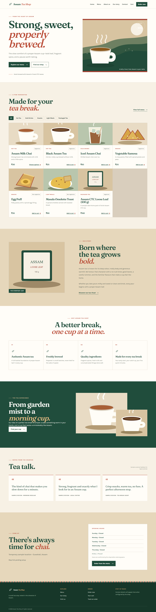
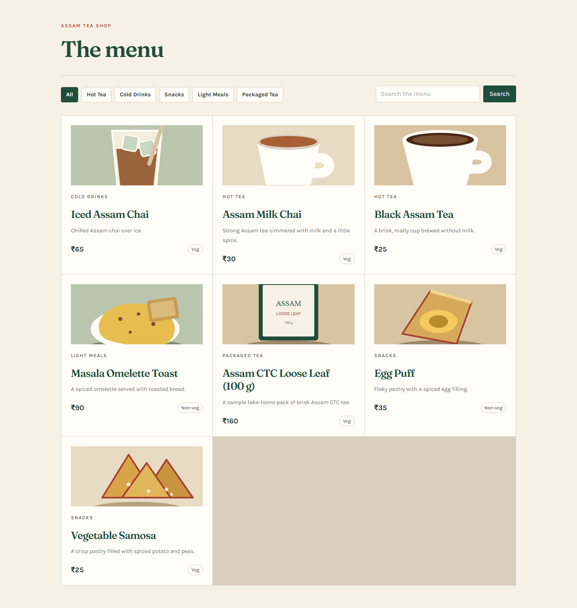
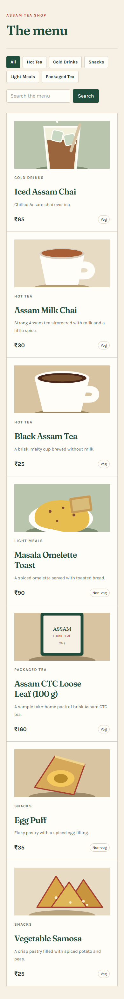
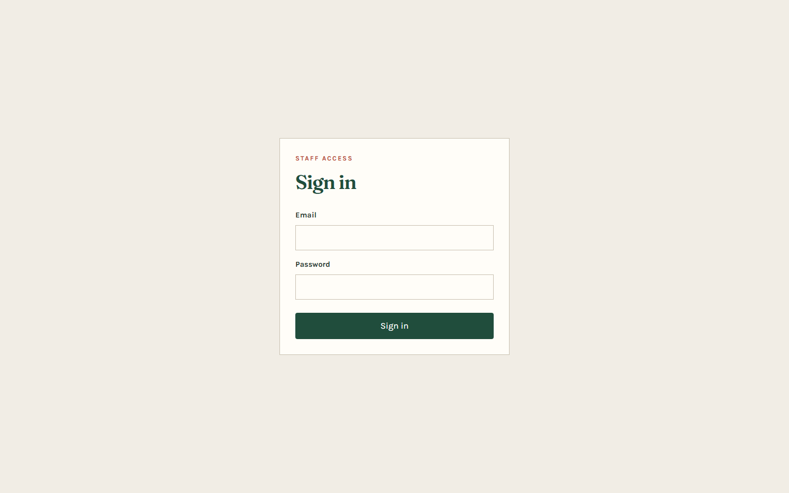

# Assam Tea Shop

Mobile-first online ordering for Assam Tea Shop. Built with Next.js App Router, TypeScript, Tailwind CSS, Prisma/SQLite, and Zod. The menu and shop settings created by the seed are **unverified development examples**, not the shop's real details.

## Requirements

- Node.js 20.9 or newer and npm.
- A valid merchant UPI ID and real business details before accepting live orders.

## Local setup (PowerShell)

1. Install dependencies:

   ```powershell
   npm install
   ```

2. Create your local environment file:

   ```powershell
   Copy-Item .env.example .env
   ```

3. Generate an admin password hash. Run the command and enter the password at the prompt:

   ```powershell
   npm run admin:hash
   ```

   Copy the printed bcrypt hash into `ADMIN_PASSWORD_HASH` in `.env`, and set `ADMIN_EMAIL`. Generate `ADMIN_SESSION_SECRET` with:

   ```powershell
   node -e "console.log(require('node:crypto').randomBytes(32).toString('base64url'))"
   ```

   Set `UPI_ID` only to the real merchant UPI ID and `UPI_PAYEE_NAME` to the verified payee name. Never use a fake ID for customer payments.

4. Generate the Prisma client and create the local SQLite schema:

   ```powershell
   npm run db:generate
   npm run db:migrate -- --name init
   ```

5. To load clearly labeled development starter data only, temporarily set `SEED_STARTER_DATA="true"` in `.env` and run:

   ```powershell
   npm run db:seed
   ```

   Then set `SEED_STARTER_DATA="false"` again. The seed shop is closed, business details are unconfigured, and its sample order is canceled and flagged as sample data.

6. Start the development server:

   ```powershell
   npm run dev
   ```

   Open `http://localhost:3000`.

## Windows quick setup

For an easy local setup from Windows:

```bat
setup.bat
```

This copies `.env.example` to `.env` only when `.env` does not already exist, installs dependencies, generates the Prisma client, and applies migrations. It does not enable starter data or insert production menu records.

Start the website with:

```bat
run.bat
```

Then open `http://localhost:3000`.

## Useful commands

```powershell
npm run lint
npm run typecheck
npm run build
npm run db:studio
```

## Launch safety checklist

- Replace all starter menu names, prices, dietary markers, and options with the verified menu.
- Set the real address, map link, and opening hours in admin settings.
- Configure the valid merchant UPI ID/payee name and upload the shop's static QR fallback.
- Set and verify admin credentials and a unique session secret in the hosting environment.
- Keep the shop closed until its details and payment destination are verified. Seed/sample data is not production content.
- Persist `/public/uploads` across deployments or configure an object-storage adapter before using ephemeral hosting.

See [context.md](./context.md), [plan.md](./plan.md), [design.md](./design.md), and [memory.md](./memory.md) for the maintained project source of truth.

## Screenshots

The screenshots use the default development environment, where the shop is intentionally closed and starter data is visible.

### Home



### Menu



### Mobile menu



### Admin login



## Refresh screenshots

With the development server running, capture updated views:

```powershell
npm run screenshots
```
